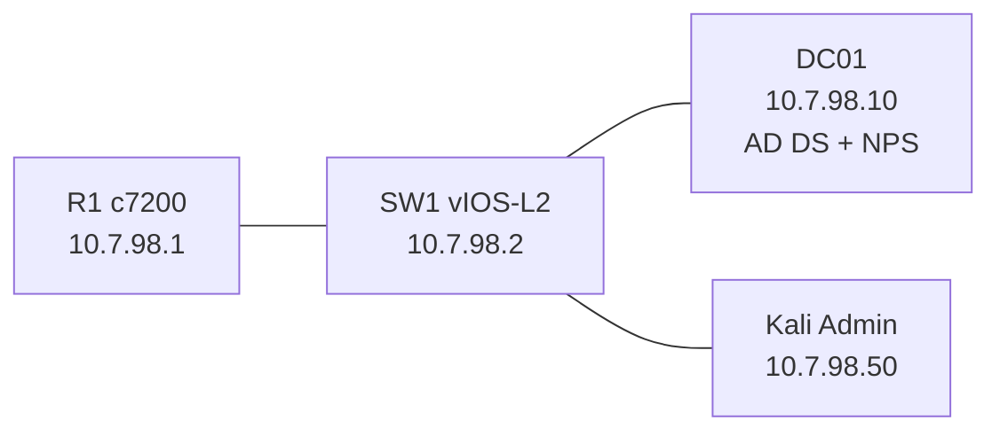

# P1 — Seguridad de Redes: Cisco AAA + RADIUS/NPS + Active Directory

> 🎥 **Video demostrativo (YouTube):** `PEGAR_AQUI_ENLACE_DEL_VIDEO`  
> 📦 **Entregable TXT:** `EmmanuelRodriguez_20250798_P1.txt`

**Autor:** Emmanuel Orlando Rodríguez Núñez  
**Matrícula:** 20250798  
**Dominio:** `redlab.local` — NetBIOS verificado: `LAB`  
**Subred de gestión:** `10.7.98.0/24`  
**Plataforma:** GNS3 + VMware + Cisco IOS 15.2 + Windows Server 2022 + Kali Linux

---

## Propósito

Implementar una infraestructura de administración segura donde R1 y SW1 utilicen Cisco AAA con Microsoft NPS/RADIUS para autenticar y autorizar sesiones de consola/auxiliar. Active Directory asigna usuarios a grupos de privilegio 0, 5 y 10; NPS entrega el nivel correspondiente y Cisco IOS aplica RBAC local. La administración remota se realiza por SSH desde Kali mediante el usuario local `admin` y una ACL limitada a la red de gestión.

## Topología




## Direccionamiento

| Equipo | Interfaz | IPv4 | Gateway | DNS |
|---|---|---|---|---|
| R1 | FastEthernet0/0 | `10.7.98.1/24` | — | — |
| SW1 | Vlan10 | `10.7.98.2/24` | `10.7.98.1` | — |
| DC01 | Ethernet0 2 | `10.7.98.10/24` | `10.7.98.1` | `10.7.98.10` |
| Kali | NIC | `10.7.98.50/24` | `10.7.98.1` | `10.7.98.10` |

**VLAN 10:** `MGMT` — puertos SW1 Gi0/0, Gi0/1 y Gi0/2.

## Componentes de seguridad

- `aaa new-model` en R1 y SW1.
- Consola/AUX con método `CON_AUX`: RADIUS → fallback local si el servidor está indisponible.
- VTY con autenticación/autorización local, acceso únicamente por SSH y ACL `SSH_ACL`.
- NPS/RADIUS en UDP 1812 (Auth) y 1813 (Accounting).
- Accounting de EXEC, system y network hacia NPS.
- Logs de login exitoso/fallido y buffer local.
- RBAC mediante niveles de privilegio 0, 5 y 10.
- SSHv2 con claves RSA y controles de timeout/reintentos.

## NPS / Active Directory

| Usuario | Grupo | Privilegio NPS |
|---|---|---:|
| `user0` | `GRP_Nivel0` | 0 |
| `user5` | `GRP_Nivel5` | 5 |
| `user10` | `GRP_Nivel10` | 10 |

Network Policies del laboratorio, en secuencia lógica de menor a mayor privilegio:

1. `Politica_Nivel_0` → `Service-Type = Login` → `shell:priv-lvl=0`
2. `Politica_Nivel_5` → `Service-Type = Login` → `shell:priv-lvl=5`
3. `Politica_Nivel_10` → `Service-Type = Login` → `shell:priv-lvl=10`

Métodos habilitados: PAP, SPAP y MS-CHAPv2. En la instancia de NPS usada para la práctica existen además directivas RD Gateway previas; por eso la captura de la consola muestra las políticas del laboratorio en posiciones globales 3, 4 y 5, aunque mantienen entre sí el orden `Nivel_0 → Nivel_5 → Nivel_10`.

## Evidencia destacada

### Windows Server / NPS


### R1 — niveles enviados por RADIUS


### R1 — user5


### R1 — user10


### SW1 — autenticación y privilegios

`user10` inicia sesión correctamente y recibe privilegio 10:


`user5` autentica correctamente por consola contra AAA/RADIUS:


### Administración SSH desde Kali

Acceso SSH local `admin` hacia SW1, con evidencia previa de privilegio 15:


Acceso SSH local `admin` hacia R1:


### Network Policies de NPS


## Estructura del repositorio

```text
.
├── README.md
├── EmmanuelRodriguez_20250798_P1.txt
├── SECURITY.md
├── .gitignore
├── configs/
│   ├── R1_config.ios
│   ├── SW1_config.ios
│   ├── R1_final_patch.ios
│   └── SW1_final_patch.ios
├── running-configs/
│   ├── R1_running-config.txt
│   ├── SW1_running-config.txt
│   └── README.md
├── scripts/
│   └── setup_ad_nps.ps1
└── docs/
    ├── Documentacion_Tecnica.md
    ├── Documentacion_Tecnica_Seguridad_Redes_20250798.pdf
    ├── Comandos_Verificacion.md
    ├── Guion_Video_10min.md
    └── evidencias/
        ├── README.md
        └── *.png
```

## Configuraciones

- [R1_config.ios](configs/R1_config.ios): configuración limpia y completa para c7200 IOS 15.2(4)S6.
- [SW1_config.ios](configs/SW1_config.ios): configuración limpia y completa para vIOS-L2 15.2.
- [setup_ad_nps.ps1](scripts/setup_ad_nps.ps1): IP, AD DS, grupos/usuarios, NPS clients y firewall.
- [Documentación técnica en PDF](docs/Documentacion_Tecnica_Seguridad_Redes_20250798.pdf): informe formal con arquitectura, configuración, validaciones y evidencias.
- [Documentación técnica en Markdown](docs/Documentacion_Tecnica.md): versión editable para consulta en GitHub.
- [Comandos de verificación](docs/Comandos_Verificacion.md): checklist técnico de Windows, R1, SW1 y Kali.
- [Guion de video](docs/Guion_Video_10min.md): demostración sugerida dentro del límite de 10 minutos.

## Prueba RADIUS validada en R1

```text
test aaa group NPS-GRP user0 Cisco1234 new-code
test aaa group NPS-GRP user5 Cisco1234 new-code
test aaa group NPS-GRP user10 Cisco1234 new-code
```

Resultados comprobados: niveles 0, 5 y 10.

## SSH desde Kali

R1:

```bash
ssh -o KexAlgorithms=+diffie-hellman-group1-sha1,diffie-hellman-group14-sha1 \
  -o HostKeyAlgorithms=+ssh-rsa -c aes128-cbc -l admin 10.7.98.1
```

SW1:

```bash
ssh -o KexAlgorithms=+diffie-hellman-group1-sha1,diffie-hellman-group14-sha1 \
  -o HostKeyAlgorithms=+ssh-rsa -c aes128-ctr -l admin 10.7.98.2
```

> Las opciones legacy se usan únicamente por compatibilidad con las imágenes de laboratorio; no representan una recomendación criptográfica para producción.

## Estado final de la práctica

La infraestructura fue validada en laboratorio con las siguientes evidencias:

- Active Directory con `GRP_Nivel0`, `GRP_Nivel5` y `GRP_Nivel10`.
- Microsoft NPS operativo como servidor RADIUS.
- R1 y SW1 registrados como clientes RADIUS.
- Autenticación y autorización de consola mediante RADIUS/NPS.
- Niveles de privilegio 0, 5 y 10 comprobados en R1; nivel 10 y autenticación de user5 comprobados en SW1.
- Administración SSH desde Kali hacia R1 y SW1 usando el usuario local `admin`.
- Accounting y registros de autenticación habilitados.
- Running-configs y scripts incluidos en el repositorio.

> El único dato externo que debe sustituirse antes de publicar la entrega es `PEGAR_AQUI_ENLACE_DEL_VIDEO` por el enlace real de YouTube.

## Documentación y evidencias

Consulta [docs/evidencias/README.md](docs/evidencias/README.md) para saber qué demuestra cada captura y revisar las observaciones de evidencia para el video.

---

> **Advertencia:** `Cisco1234` es una credencial desechable de laboratorio exigida para esta práctica. No reutilizarla en entornos reales.
